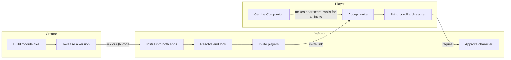
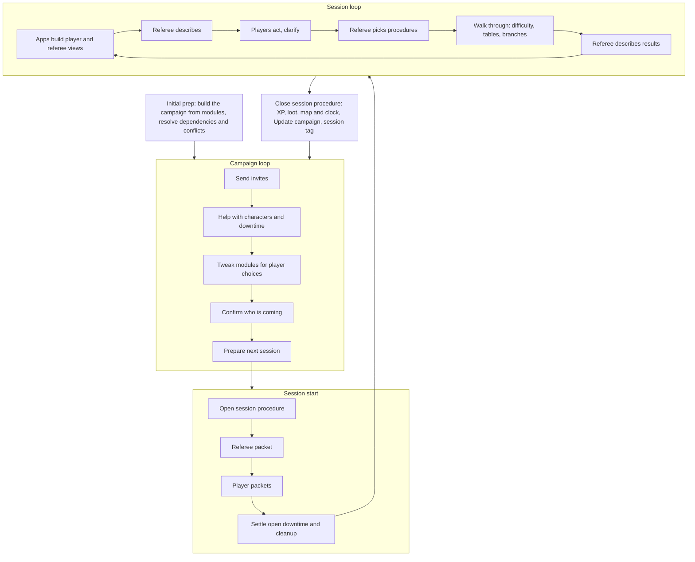

# E9 Workflows and Module Versioning

Status: agreed design, 2026-11-05 and 2026-11-07 (Heph). Not yet built. First draft: [Claude Doc](https://claude.ai/artifact/UpHCiv8Spi32u4nv3jDeDu). Ideas not yet agreed are in [PROPOSALS.md](PROPOSALS.md).

## Summary

A module travels as one link. The referee stacks modules into a campaign that pins exact versions, and every conflict, update or ported character goes to the referee as a decision in the Inbox. This builds on what already exists: the mm-module/1 manifest ([MODULE_FORMAT.md](MODULE_FORMAT.md)), campaigns as git repos, and the Inbox approval flow.

**Everything is a module.** The core rules ship as modules (`e9-core`, `mm-core`), so the revised Compendium is a major update to `mm-core`. The apps are modules too (`e9-companion`, `e9-atlas`), so a module can require the app version it needs, and nothing exists outside the system.

| Piece | When |
| --- | --- |
| Module manifest with ids, versions and relationships | MVP |
| Atlas and Companion ingest from one link or QR code | MVP |
| Campaign lockfile and dependency check | MVP |
| Updates: one "Update?" card with the release notes | MVP |
| Invites: one seat per player, a join code becomes the invitation ([Invitations](#invitations)) | MVP |
| Porting characters: a plain "made under different rules" warning | MVP |
| Conflict review, per-id update review, full porting check, bundles and signatures | After the MVP, once a second author's module can join a campaign (Heph 2026-11-08) |
| E9 Scribe, the creator app: its campaign view (pick a root, stitch modules, settle conflicts, house rules) on a shared editing engine | MVP (Heph 2026-11-08) |
| Gutenberg (working name), Scribe's publisher module: releases, signing, QR codes, print | Post-MVP |

Until Scribe's full module editing exists, modules are made with our repo tools (`tools/build.py` and the format specs).

## Three workflows

The three roles meet at two handoffs: the module link (creator to referee) and the invite (referee to player). Everything else each role does on their own.



- **Creator:** builds module files with our tools, releases a version, publishes the link, and puts its QR code on the back page of the print PDF.
- **Referee:** installs from the link (Atlas takes the setting, Companion the rules and NPCs), resolves conflicts and dependencies, adds house rules, locks versions, then invites players.
- **Player:** gets the Companion and maybe makes characters, accepts an invite, then sends an existing character or rolls a new one. The character arrives in the referee's Inbox for approval.

## Module package

A module is a git repo with one manifest at a stable URL, and that URL is the only thing anyone needs to install it.

- **Link format:** `https://<host>/<module>/module.json`, plus an optional `#v=1.2.0` to point at one version. Without a version, the app offers the latest one.
- **QR code:** printed on the back page of the print PDF. It encodes that same link, with the version that matches the printed book.
- **Two halves:** Atlas reads the setting half (regions, maps, sites, hex content). Companion reads the rules half (classes, gear, spells, creatures, NPCs, procedures, events). A module may have only one half, such as a pure rules supplement.
- **Releases are immutable.** Each version is a git tag, and its files never change after release. Errata ship as a new patch version.
- **Hosting:** GitHub Pages is the default, as now. Any static host works because the apps only read files.

## Versioning

Every piece of content has a permanent id, and each module's version number says whether an update can break the characters and campaigns that use it.

**Stable ids.** Ids look like `<module>/<kind>/<slug>`, for example `e9-core/spell/sleep` or `beyond-the-pale/creature/crom-cruach`. An id is never reused for something else. Renaming the display name is fine; renaming the id is a breaking change. Characters, parties and house rules point at ids, never at copies.

**Semantic versions, defined for game content** (the [semver](https://semver.org) rules, with game meanings):

| Bump | Example | Meaning for E9 |
| --- | --- | --- |
| Patch | 1.0.0 to 1.0.1 | Errata, typos, art, map fixes. No stat or rule changes anyone has to notice. |
| Minor | 1.0.1 to 1.1.0 | New content added. Existing ids keep their meaning. |
| Major | 1.1.0 to 2.0.0 | An id removed or renamed, a stat or rule changed in a way that changes existing characters or encounters. |

Each module, each app (Hexmarch Companion, Hexmarch Atlas, Hexmarch Scribe) and the tools keep their own version (Heph 2026-11-06). A change to the tools or an app alone never bumps a module's version, and a module's content change never bumps an app. Each module keeps a `CHANGELOG.md` next to its `module.json`.

Versions before 1.0.0 make no promises, as in semver.

**The apps' road to 1.0 (Heph, 2026-11-09; replaces the 1.0.0-alpha/-beta plan of 2026-11-08).** All the apps (Hexmarch Companion, Hexmarch Atlas, Hexmarch Scribe) move through the same minor versions together. Each sprint is one minor:

| Version | Sprint |
| --- | --- |
| 0.5.X | **Alpha:** the first full walkthrough: create a campaign in Scribe, invite, accept, roll a character, approve it, explore the map as that character. Then Scribe makes other sample systems work. |
| 0.6.X | **Integration sprint:** real-life tools in the workflow, only ones that cost nothing, including the fundamentals of remote play (the tools that carry it). Scribe skips ahead to 0.6 if needed. |
| 0.7.X | **UX sprint:** a UX pass, including privacy and encryption (seats, join codes, per-character secrets), content readiness and the remote-play experience. |
| 0.8.X | **Private alpha:** real campaigns with invited tables, and their feedback. |
| 0.9.0 | **Format lock:** the formats freeze. After this, a format change needs a migration and a major version. |
| 0.9.X | **Public beta**, open to everyone. |
| 1.0.0 | **Release and maintenance.** |

The 0.8 and 0.9 versions are plain semver minors (no `-alpha` or `-beta` suffix), so npm, version ranges and sorting work as usual. The Compendium's revised edition (January 2027 at the earliest) would be a major version of `mm-core`.

**Release notes.** Every release lists its added, changed and removed ids. The apps use this list to show the referee what an update does.

### Protocol names (Heph, 2026-11-09)

The apps run any OSR hexcrawl core rules, so the names machines read say **hexmarch**, not E9 or MM. That covers format ids, the discovery file, messages between apps, browser storage keys, file extensions, app ids and sheet layout tags. Ids keep the name even if the apps are renamed later. Content stays as it is: module ids `e9-core` and `mm-core`, their content ids (`mm:longsword`, `e9-core/spell/sleep`), and a module's own data files.

The rename lands in 0.6.X, before the 0.9.0 format lock. Apps write the new names. Readers accept both the new and old names until 1.0.0, so existing files, links and saved data keep working. Browser storage moves to the new keys once, on first start.

| Old | New |
| --- | --- |
| `e9-campaign-pointer/1`, `e9-snapshot/1`, `e9-campaign-state/1`, `e9-mail/1`, `e9-lock/1`, `e9-scribe-campaign/1` | `hexmarch-campaign-pointer/1`, `hexmarch-snapshot/1`, `hexmarch-campaign-state/1`, `hexmarch-mail/1`, `hexmarch-lock/1`, `hexmarch-scribe-campaign/1` |
| `e9-rules/1`, `e9-derive/1`, `e9-procedures/1`, `e9-bestiary/1`, `e9-encounter-map/1` | `hexmarch-rules/1`, `hexmarch-derive/1`, `hexmarch-procedures/1`, `hexmarch-bestiary/1`, `hexmarch-encounter-map/1` |
| `e9-atlas/1`, `e9-atlas-cache/1`, `e9-vtt/1`, `e9-vtt-links/1` | `hexmarch-atlas/1`, `hexmarch-atlas-cache/1`, `hexmarch-vtt/1`, `hexmarch-vtt-links/1` |
| `mm-module/1`, `mm-module/2`, `mm-repo/1` | `hexmarch-module/1`, `hexmarch-module/2`, `hexmarch-repo/1` (version numbers carry over) |
| `mm-campaign/1` | read only, never written |
| `mm.json` (a repo's discovery file) | `hexmarch.json`; readers try `hexmarch.json`, then `mm.json` |
| messages `e9-atlas`, `e9-bridge` | `hexmarch-atlas`, `hexmarch-bridge` |
| storage keys `e9-*`, `mm-lang` | `hexmarch-*`, `hexmarch-lang` |
| `<id>.e9atlas.json` | `<id>.hexmarch-atlas.json` |
| app ids `e9-companion`, `e9-atlas` | `hexmarch-companion`, `hexmarch-atlas`, `hexmarch-scribe` |
| sheet tags `<e9-value>`, `<e9-each>`, `<e9-if>`, `e9-class`, `e9-action`, `e9-roll` | `<hexmarch-value>`, `<hexmarch-each>`, `<hexmarch-if>`, `hexmarch-class`, `hexmarch-action`, `hexmarch-roll` |
| `web+e9:` (planned link scheme) | `web+hexmarch:` |

The full scan is in the project files (strategy/protocol-names-scan.md).

## Dependencies

Each manifest says what it needs and what it touches, using the relationship types that [Foundry VTT](https://foundryvtt.com/article/module-development/) and [Factorio](https://wiki.factorio.com/Tutorial:Mod_structure) mods use.

| Field | Meaning | Example |
| --- | --- | --- |
| requires | Must be present, within a version range | `e9-core ^1.0` |
| recommends | Offered at install, can be skipped | `e9-bestiary ^1.2` |
| conflicts | Cannot share a campaign | `other-setting <2.0` |
| overrides | Ids from another module this one deliberately changes | `e9-core/spell/sleep` |
| system | Which rule system it is written for | `e9`, `mm`, or both |

Version ranges use the npm style: `^1.2` means 1.2 or any later 1.x. An override that is declared is applied quietly. Two modules changing the same id without declaring it is a conflict, and it goes to the referee.

```json
{
  "id": "beyond-the-pale",
  "version": "1.0.0",
  "system": ["e9", "mm"],
  "requires": { "e9-core": "^1.0", "e9-companion": "^0.5" },
  "recommends": { "e9-bestiary": "^1.0" },
  "overrides": ["e9-core/creature/goblin"]
}
```

**Honest contents.** A module may hold anything: both systems, setting and rules, art, procedures. But its manifest must list everything it contains, grouped by kind and system, with a count per group. The apps check the list against the actual files on install, and a mismatch is shown to the referee as a warning.

## Trust: bundles and checkers

Anyone can publish any module, overrides included. Trust comes from curators and checkers that the referee chooses, not from a central gatekeeper.

- **Bundles.** A bundle is a small signed list that says, in effect, "I'm Heph Fnord, and I think this curated list is pretty neat." It names modules with version ranges and an optional note for each. A bundle is itself a module, so it is versioned, linked and installed the same way. Installing a bundle offers its modules; it never installs anything silently.
- **Authors and curators.** Each manifest and bundle names its author and is signed with that author's key, so a copy can't pretend to be someone else's. The referee keeps a list of authors and curators they follow. Modules from outside that list install fine, but are marked as unvetted.
- **Checkers.** A checker is a script, shipped as a module, that reads a module and reports on it: honest contents, valid ids, power level against a reference, house style. Referees run the checkers they choose, or write their own. Official ones ship with `e9-core`.

This follows how package ecosystems like npm and Debian handle trust: open publishing, signed releases, and lists the user decides to believe.

## Campaign stack

> Since 2026-11-08 a campaign is itself a private module, and this stack is that module's dependencies: see [Campaigns are private modules](#campaigns-are-private-modules).

A campaign is a stack of layers with one exact version each, and nothing changes in it until the referee says so.

1. **Core rules** (`e9-core` or `mm-core`).
2. **Modules**, in the order the referee sets. A later module wins over an earlier one.
3. **House rules**, always on top. This layer also stores every conflict decision the referee makes.

**Lockfile.** The campaign repo keeps `campaign.lock.json`, listing each module's exact version and a hash of its manifest, like npm's `package-lock.json` or Cargo's `Cargo.lock`. Players' apps load exactly those versions, so everyone at the table sees the same rules.

**One version per module.** npm can load two copies of a library side by side, but a campaign cannot have two Sleep spells. If two modules need incompatible versions of a third, the app reports it and the referee picks one or drops a module. There is no automatic solver.

**Updates.** The app checks the modules' links for newer versions and puts them in the Inbox. Patches and minors show their release notes and one Accept button. A major shows every changed or removed id that the campaign's characters actually use, and the referee decides per item.

**Conflicts.** At install and at every update, the app lists each id that two layers change without a declared override. For each, the referee picks one version, or writes a house-rule version. Like the user rules in the mod tool [LOOT](https://loot.github.io/), these decisions are saved in the house-rules layer, so they are still applied after the next update. A decision whose underlying id changed in an update is flagged for a second look.

**Slicing a module.** The referee can take the peas and leave the carrots. In the house-rules layer they can exclude any id, any group in the module's contents list (all its spells, say), or one system's half. Excluded content behaves as if it were missing: anything that needs it is flagged, the same way a conflict is.

**Players see the decisions.** Every conflict decision, exclusion and house rule is visible to players, with the referee's note. The referee can mark one decision as a spoiler, and players then see only that something was changed, not what.

## Porting characters and gear

A character from another campaign or ruleset arrives as an Inbox request, and the referee decides how to patch anything that doesn't fit.

1. The player picks an existing character and sends it with the join request, or sends it later.
2. The app checks every id on the sheet (class, origin, gear, spells, dweomers) against the campaign's lockfile.
3. Each id falls into one of four groups: **matches**, **different version** (the stats changed between versions), **missing** (its module isn't in the campaign), or **different system** (for example, a Materia Mundi character joining an E9 campaign).
4. The referee sees one review card with every flagged id. For each one they can keep it as house-ruled content, swap it for an id the campaign has, or remove it.
5. Approving writes the patched sheet into the campaign repo. The player's original stays untouched on their device.

The sheet's own history (creation and level-ups) is kept, so a ported character can be traced back. Gear on its own (a magic sword handed between campaigns) goes through the same check.

## Playing a campaign

Agreed with Heph, 2026-11-07. Everything a referee does at or between sessions runs on **one engine: Procedures** ([EVENTS_FORMAT.md](EVENTS_FORMAT.md)). Opening and closing a session, advancing the clock by hand, downtime and pushing a handout are all procedures, and each game defines its own.

### Devices: the phone is your hand, the laptop is your table

One person can be signed in on several devices at once. Pairing: the laptop shows a QR code, the phone scans it.

| Device | Role | Holds |
| --- | --- | --- |
| Referee laptop | Command centre, and the session host | Atlas (full map), Events log and trigger queue, open encounter, Inbox, clock |
| Referee phone | Remote | Dice, private notes, one-tap "run next trigger", "advance a turn", "call for a roll", rules lookup |
| Player phone | Hand (must be complete on its own) | Character sheet, dice, roll prompts, live HP, conditions, slots |
| Player laptop | Window (bigger views only, nothing laptop-only) | Player Atlas view, party, journal, rules wiki, session notes |
| Any screen (optional) | Table view, signed out | Shared map and roll log |

### Accounts

| Who | Account | Used for | Substitute |
| --- | --- | --- | --- |
| Everyone | Gmail | Sign-in, session calendar invites and RSVPs, the campaign Drive folder | Any email sign-in or passkey, later |
| Everyone, if online | Discord | Voice; webhook roll log; pushed descriptions and handouts where Discord fits best | none needed in person |
| Referee | GitHub | Campaign repo (the archive) and module library | Codeberg / Forgejo via the host adapter |
| Referee | A VTT | Tactical maps and tokens for fights | Foundry, Owlbear Rodeo or gTove |

Players need no GitHub account.

### Mailbox and archive

> Since 2026-11-08 the mailbox, snapshots, handshake and calendar are swappable between Google, Discord and other services, and players need only URLs. Google, below, is one adapter: see [Services and adapters](#services-and-adapters).

- **Mailbox:** a shared Google Drive folder per campaign. The referee's app creates it and shares it with the players' Gmail addresses when it sends invites. A player's request is a small file the app drops into the folder's inbox; the referee's app picks it up and removes it once handled. Each Update campaign also writes the current campaign snapshot here, so players can read a private campaign without GitHub.
- **Archive:** the campaign git repo. **Only the referee writes to it.**
- **Request states:** Sent → Approved (waiting in the batch) → Live, or Sent back with a note. Approvals collect in a batch; **Update campaign** commits the batch as one commit with a readable message. Closing a session is one more Update campaign plus the session tag.
- A small relay (Cloudflare) is added later only for players without Google.

### Invitations, modes and who writes what

Agreed with Heph, 2026-11-09. The Companion has two display modes, chosen by the invitation you pick in its campaign switcher.

- **Invitations.** There are two kinds: **Referee** and **Player**. A Player invitation plays one character. One person may hold several invitations, and the switcher lists each one, so the same campaign can appear more than once. They are kept on the device under `invitations` (the Companion's `src/lib/invitations.ts`, in the apps repo).
- **Modes.** Referee mode shows everything: every map, every creature and every party. Player mode shows:
  - your character and its followers
  - your party
  - the NPCs your character has met or heard of
  - the state file, read-only
  - the Atlas locked to what your character knows

  Met and heard of work like visited and rumoured hexes: a knowledge entry with `creature`, and `"rumour": true` while it is only hearsay.
- **Labels.** A new Player invitation reads "Kells 1422 · (Roll a character)" until the player picks or makes one, then "Kells 1422 · Playing Holly". A Referee invitation reads "Kells 1422 · Referee".

The round trip:

1. **Scribe** saves a ready campaign on the creator's device and writes the creator's Referee invitation.
2. **The referee's Companion invites players** with a link carrying the campaign's read address and, per P1, the mailbox address. A campaign kept only on the referee's device (one Scribe saved, not yet published) can't be opened by anyone else, so **Invite a player is unavailable until the campaign is published** (campaign repo or mailbox snapshot).
3. **The player's Companion** adds the invitation as "(Roll a character)". The player picks or rolls a character, and the label becomes "Playing Holly". The character goes to the referee as a request (Sent → Approved → Live) and joins the party in the state file once approved.
4. **Who writes what.** Every device that plays a character holds a copy of it. The four parts of a creature ([CREATURES_FORMAT.md](CREATURES_FORMAT.md) 2.1) say who writes each one:

   | Part | Written by | How it reaches the other side |
   | --- | --- | --- |
   | stats, gear, flavor | the player | a request the referee approves |
   | knowledge | the referee only (meetings, rumours, Atlas travel, the fog brush) | the next published snapshot |
   | state file (clock, party position, what everyone knows) | the referee only | the next published snapshot |

   Because the referee never writes a player's stats or gear, and the player never writes knowledge, the two never collide.
5. **The player's Atlas** shows only what has reached the player's device. In player mode nothing changes the map until the referee's next update arrives.
6. **Leaving.** When the referee removes a player, that player's invitation stays on their device, read-only, as "Kells 1422 · (left the campaign)". It does not vanish.

### Live channel (remote play is a must)

- The **referee's laptop hosts the session**. Every other device connects straight to it, peer to peer (WebRTC).
- The **handshake goes through the Drive folder**: a joining device drops a "here I am" file and the host answers. No server of ours.
- **Fallback:** if a direct connection fails, that device sends its messages through the Drive folder (a few seconds each).
- **Discord** carries voice; the webhook mirrors every roll into the campaign channel.
- The session runs while the referee's laptop has the campaign open.

### VTTs

The Atlas already exports every encounter map as .uvtt plus a picture-only PNG ([ENCOUNTER_FORMAT.md](ENCOUNTER_FORMAT.md)). Foundry is the first adapter. Owlbear Rodeo takes the PNG, with walls and fog via an extension. **gTove** (no .uvtt) stores its maps in Google Drive, so the Atlas can drop the PNG into the gTove folder and the referee sets the grid once to the known scale; fog is painted by hand. To check before building: whether gTove can read the grid from the file.

### Downtime

Downtime actions are procedures, and each game sets its own (including any limits).

1. The player picks a downtime procedure in the Companion; the app rolls.
2. The roll posts at once to the campaign's Discord channel, marked pending ("Aoife carouses in Ceanannas Mór: 14 (pending referee)"). The post is a public witness: a reroll is a second post.
3. The same roll goes into the Drive mailbox as a request, with the Discord message id.
4. When the referee approves or sends it back, their app edits the Discord post to say so, and the result joins the Update campaign batch.

### The loops



**Initial prep.** Install modules, resolve dependencies and conflicts (Campaign stack, above).

**Campaign loop.**
- Send invites (link or QR code; shares the Drive folder).
- Help players with character creation and downtime (requests in the Inbox).
- Tweak modules for player choices (house-rules layer).
- Confirm who is coming: RSVPs on the session's calendar invite feed the next roll call.
- Prepare the next session.

**Session start.** The **Open session** procedure starts the clock and builds the hand-off packets:
- Referee: recap of the last session's log, pending requests, party position, scheduled events, prepared encounters.
- Each player: their character, the recap, handouts.
- Any unresolved downtime or cleanup is settled before play.

**Session loop.**
1. Atlas and Companion build the player-visible and referee-visible views of the current world state.
2. The referee describes the world.
3. Players describe their actions; back and forth to clarify.
4. The referee decides which procedures apply. The app shortlists them from context (in a hex: exploration turn, forage, get lost; at a door: listen, force, pick); the referee taps one.
5. The referee walks the players through it, choosing difficulty, tables and branches as they come up. Rolls go to players' phones or are rolled by the referee (EVENTS_FORMAT section 9).
6. The referee describes the results, and can **push** a description or handout to players, in the app or in Discord, whichever does the job best.
7. Loop.

**Session end.** The **Close session** procedure runs the game's XP and loot rules and proposes map and clock changes; the referee edits and approves; Update campaign commits it with the session tag. Back to the campaign loop.

**Advancing the clock by hand** is a deterministic procedure, not a special control.

## Sub-refs and West Marches

Agreed with Heph, 2026-11-07. A West Marches campaign has several referees, a party that forms fresh for each session, and one shared world. It uses the same model as above, one level up.

- **Head referee** owns the campaign repo and has the final say.
- **Sub-refs** are referees with a scope the head ref grants: a **region** of the Atlas (or a site or faction), **any session they run**, or both. The head ref chooses per sub-ref.
- **Secrets are scoped.** A sub-ref sees referee-only data inside their scope and nothing outside it.
- **Git.** Each referee writes their own session branch. A sub-ref's Update campaign becomes a request to the head ref, in the same Inbox flow players use. The head ref can mark a sub-ref as trusted, so their changes merge on their own, but only when nothing conflicts.
- **Conflicts between sessions** (two groups loot the same barrow) always go to the head ref, who decides.
- **Sessions.** Each session is posted to the calendar and Discord; players sign up; the party exists for that session only. Whoever runs it hosts the live channel. A game can require "end every session back in town", so characters are never stranded in a state another session collides with.
- **Shared map.** What any group explores is added to one player-visible Atlas layer that all players see.
- **Game time** (1:1 with real time, a clock per session that is reconciled later, or anything else) is set by a **procedure** the head ref picks, like everything else.

## Services and adapters

Agreed by Heph, 2026-11-08 17:40. Moved here from PROPOSALS.md.

**Idea (Heph, 2026-11-08):** don't tie campaign play to one outside service. Make it an open, flexible system: Google is one option, Discord another, and so on, plus a small handler on our end.

Today WORKFLOWS.md uses Google (with Gmail sign-in for everyone) for the mailbox, snapshots, the live-channel handshake and the session calendar, with GitHub as the referee's archive. This proposal keeps those as defaults but makes each one swappable, the same way the git host adapter already plans for GitHub first and Codeberg or Forgejo later.

### First principle: players need only URLs (Heph, 2026-11-08)

The player side is utterly tech-agnostic: **if a player can open URLs, they're in.** No account anywhere, no particular phone. Accounts (Google, Discord, GitHub, a VTT) are a **referee-side** choice only. Every adapter therefore has two halves: the referee half may sign in to a service, and the player half may only fetch and post to URLs.

- **Reading** is any public URL the referee's adapter publishes: a Drive "anyone with the link" file read through Google's API with no sign-in, GitHub Pages, or any static host. Snapshots hold only player-visible content, and the link is unguessable.
- **Writing** is a URL the player's app can post to:
  - a **Discord webhook** (just a URL; the player needs no Discord account),
  - a **Google Form** (anonymous submissions into a Sheet the referee owns; the app can't confirm delivery, and Google could change it),
  - **our handler** (a per-campaign mailbox URL),
  - the **live channel** straight to the referee's laptop during a session.
- **Identity** is a key, not an account. Each device makes its own key pair and signs its envelopes; the referee approves that key when the player joins. A player is "the device holding this key".
- **The invite link carries everything:** where to read, where to post, and the campaign's id. Tap or scan it and you're in.
- **Receipts close the loop.** Every envelope has an id. Whenever the referee's app runs, it collects new requests and writes a receipt list (the ids it has seen) into the public snapshot. The player's app reads it and shows **Sent → Received → Approved** (or Sent back). If an envelope is still missing after the referee's next sync, the player's app sends it again, and the id stops it from being counted twice. Nobody confirms anything by hand. With a post URL that can't answer (a Google Form), "Received" only appears once the referee's app has run, which can be hours between sessions.
- **Apps Script web app (likely better than a Form).** A small script in the referee's own Google account, hosted free by Google, gives a post URL that answers. The player sees "Received" at once, even with the referee's laptop closed. It can also hold the live channel's handshake for remote players, closing the gap below. It runs on the referee's account, so it is still not a server of ours. **To check:** that a browser page can read its reply, and how simple the one-time setup can be for a referee.
- **The same script as a polling Discord bot.** A time trigger runs it with nobody online, as often as once a minute. It calls Discord's API from Google's servers with the bot token kept in the script, so browser limits don't apply (this also sidesteps the Discord browser-read test). Each run it reads new channel messages, posts receipts and replies, edits pending downtime posts once the referee's app approves them, and posts session events. Every 5 minutes uses about 15 of a free account's 90 trigger minutes a day. **It can't:** hold Discord's live gateway connection (runs stop after 6 minutes), and probably can't serve slash commands or buttons, which need an answer within 3 seconds plus a signature check that Apps Script lacks (untested). Live features and buttons stay with the referee's open app or our handler.
- So **one script in the referee's Google account** can be the instant post URL, the remote handshake, and a 1–5 minute Discord bot.
- **Handover between the script and the referee's app (Heph, 2026-11-08).** With the referee online, their Companion or Atlas is the live Discord bot; offline, the script batches every few minutes. The script can't call the app (a browser app has no address), so the app announces itself:
  1. The referee's app opens and checks in with the script: "I'm here; give me everything since message X."
  2. The script hands over its backlog and the **cursor** (the last Discord message handled).
  3. The app takes a **lease**, checking in about once a minute. While the lease is fresh, the script's runs do nothing.
  4. Live mode: the app handles Discord in real time.
  5. When the app closes or crashes, the lease runs out after a few minutes and the script carries on from the cursor.

  One cursor plus one lease means nothing is handled twice and nothing falls through the gap. Only one device holds the lease, normally the referee's laptop (the session host). **To test:** whether a browser can hold Discord's live gateway connection (a WebSocket, which browsers usually allow even when the REST API is blocked). If it can listen but not post, the app listens live and posts through the script.
- **One gap:** the live channel's handshake for remote players needs a meeting point both devices can write to (the handler, the webhook, or a pasted code). In person, a QR code covers it.
- **Apple:** an iPhone user without Google has iCloud Drive, but a web app can't use it. Apple's web route (CloudKit JS) only reaches a container our app owns and needs a $99/year developer account. Under this principle it isn't needed on the player side; it could become a referee-side adapter later.

### Jobs, not services

The apps ask for only five things. Each one is a small interface, and any service that can do the job can implement it.

| Job | What the apps need | Used for |
| --- | --- | --- |
| **Who** | Sign in (referee side); say who a person is (a device key on the player side) | Invites, request authors, scoped referee roles |
| **Mail** | Send a request; list waiting ones; mark one handled | Player requests, approvals, downtime, sub-ref requests |
| **Store** | Write and read a campaign snapshot | Players reading a private campaign between sessions |
| **Signal** | Pass a few small messages so two devices can find each other | The live channel's handshake, and its slow fallback |
| **Schedule** | Post a session; collect RSVPs | The roll call before each session |

The **archive** (the campaign git repo, written only by the referee) stays as it is: git is already behind its own host adapter.

### One envelope

Every request, approval, handout, snapshot notice and handshake travels as one small JSON message (working name `e9-mail/1`): who sent it, to whom, which campaign, a kind, a body, and an id. Adapters only move envelopes and never read the body, so a new service never touches game logic.

### Adapters, mixed per campaign

The campaign file says which adapter does each job, so a table can mix them. For example, Discord for Mail and Signal, GitHub for Store, Google for Schedule. Another table might use Google for everything.

| Adapter | Who | Mail | Store | Signal | Schedule | Notes |
| --- | --- | --- | --- | --- | --- | --- |
| **Google** | Gmail sign-in (referee) | Drive folder inbox (players post to an Apps Script web app, or a Google Form) | Drive folder | Apps Script web app, or Drive files (slow) | Calendar invites and RSVPs | No server of ours. Needs a Google Cloud OAuth client (`drive.file`). The current default. |
| **Discord** | Discord sign-in | Channel messages (players post through a webhook) | Channel attachments | Channel messages | Scheduled events ("Interested") | Discord keeps the messages, so the channel itself is the mailbox. The referee's open app acts as the bot, with the token on that device only. **To test:** whether Discord's API lets a browser page read channel messages. If not, reads go through the referee's Apps Script bot or our handler. |
| **GitHub** | GitHub sign-in | Issues | Repo files | Issues (slow, rate-limited) | none | Every user needs a GitHub account, so it fits referees and sub-refs best. |
| **VTT** (Owlbear Rodeo, Foundry) | Room or world members | During a session only | none | Strong: Owlbear broadcasts, Foundry sockets | none | Live channel only. A table already in a VTT can skip WebRTC. |
| **Our handler** | Relays sign-in | Holds mail for players with no account anywhere | Short-lived only | Yes | none | See below. |
| **Manual** | Typed name | Copy and paste a file or link | Download and upload a file | Paste a code | none | Always available, so nobody is locked out. |

GitHub Actions is not a host for the handler. Its jobs can't stay connected or receive calls. A scheduled workflow could poll a Discord channel into the repo, but private repos only have the free minutes for about one poll every 30 minutes, and GitHub's terms limit Actions to the repo's own build and publishing.

### The Link adapter: messages as links (Heph, 2026-11-09)

A message small enough to fit in a link travels as one, so neither side needs a host or a post URL.

- **The data rides after `#`.** The app compresses the envelope and puts it in the link's fragment (`<app>/#m=<data>`). Browsers never send the fragment to the server, so the message goes straight from the link into the app on the device that opens it.
- **Shared, not just emailed.** The app's **Share** button opens the device's share sheet, so the link can go by email, SMS, a chat app or Discord, whatever the table uses. On a laptop it copies the link.
- **The 4096-byte rule.** A message whose link fits in **4096 bytes** may travel as a link. Anything larger needs a **publicly addressable URL** (the hosted snapshot, or a file on any static host). The link is then still a small JSON envelope, whose body is just that URL (Heph): the app opens the link, sees a URL, and fetches the rest from there.
- **What fits:** join requests (a character without its portrait), sent-back notes, receipts, and **per-player updates**: the shared state plus that one player's own knowledge. Each player gets only their own link, which keeps their secrets out of everyone else's hands even before encryption.
- **What doesn't:** portraits, maps, a long history, a whole snapshot. These stay at the hosted URL.
- **Limits:** the sender can't see that a link was opened until the other side sends something back. On Android a tapped link may open the browser rather than the installed app; both share the same storage, so the message still lands.
- **Cost:** none. No accounts, no server. Built in 0.6.X ("real tools that cost nothing").

### Apps talk by links (Heph, 2026-11-09)

The Companion, the Atlas and Scribe **do not rely on shared browser storage** to hand each other data. They send each other **messages, and a message is a link**: the Link adapter turned inward, with the same `e9-mail/1` envelope.

**Why.** In the first alpha walkthrough, Scribe and the Companion were installed from different browser profiles. Each kept its own storage, so the Companion never saw the campaign Scribe had made, and nothing said so. With shared storage, a second profile, a second browser, cleared site data or a new laptop all fail silently. A link either opens and delivers its data, or visibly doesn't.

- **The button is a link.** "Open in the Companion", "Update", "Show on the map" and the like are links to the other app (`<site>/scribe/#m=<data>`, `<site>/#m=<data>`, `<site>/atlas/#m=<data>`). On one machine the button opens the other app. Copied to another device, the same link does the same thing.
- **The data rides after `#`**, compressed, so it never reaches the server or its logs.
- **Send changes, not everything.** "Approved Meadowblossom" carries one character and one receipt. Between apps a link may be far longer than the 4096 bytes allowed for links sent through email or chat, because browsers accept links of about 2 MB. Still, anything that doesn't fit goes by publicly addressable URL or by file, and the link then carries only that URL.
- **Safe to open twice.** Every message has an id; the receiving app ignores one it has already applied.
- **Each app owns its own data.** Scribe owns the campaign's definition (modules, lock, house rules, starts). The Companion owns characters, requests and answers. The Atlas owns what it draws from: the party's position and fog. Each sends the others the changes they need and keeps its own copy in its own storage.
- **Storage is a cache.** An app's browser storage is a fast local copy, never the only one.

**What goes where (Heph, 2026-11-09).**

- **Big files, at a publicly addressable URL:** core rules and other modules (with their maps, tiles and bestiaries); campaign logs and history; images (portraits, handouts); and a **full snapshot** for a device that starts from nothing (a new player, a rescued seat, a new referee laptop).
- **Everything else travels as a series of update links**, each a small JSON packet: every change, request, answer, reveal and knowledge entry. A character without its portrait is small; its portrait goes by URL.
- **Updates are numbered.** Each update carries a running number per campaign. A device that receives update 43 without having seen 42 knows it missed one: it reads the full snapshot from the URL and carries on from there. A lost or out-of-order link costs one download, never a broken campaign.

**The referee's durable copy is the campaign folder.** A campaign is a module, so its home is a folder of small files with a manifest that links to them:

```
kells-1422/
  module.json            manifest: links to everything below
  campaign.lock.json     the pinned modules
  campaign/state.json    clock, party, common knowledge
  campaign/characters/   one file per character or creature, with its knowledge
  campaign/mail/         requests and answers
  campaign.json          public pointer    } what players read
  snapshot.json          public snapshot   }
```

A zip of the folder is how it travels in one piece, never its working form. On a laptop with Chrome or Edge, the apps can open the folder itself and read and write it. Elsewhere it lives in Drive or git, written through the referee's own sign-in. Players never need it: their devices hold only their own character and the snapshot, which the referee can always rebuild ([Rescuing a seat](#rescuing-a-seat-heph-2026-11-09)).

**Still open:** where the referee's folder lives by default (on disk, Drive or git), and how often the apps remind the referee to save to it.

### Our handler

A free Cloudflare Worker, owned by Heph, that does only what a browser can't:

- Trade sign-in codes for tokens, which needs a secret (GitHub App, Discord).
- Relay calls to APIs that refuse browser pages.
- Give Discord buttons and slash commands an address to call.
- Hold mail briefly for a player who has no account anywhere.

It keeps no campaign data, which always lives in services the referee picked. If the handler goes away, tables using Google or Discord directly keep working. It is the same Worker WORKFLOWS.md already plans for the sign-in relay.

### Resilience (Heph, 2026-11-08)

Assume any service can vanish overnight (shutdown, API or price change, banned account, new policy). Nothing may be lost, and switching must be cheap.

| If this goes | What stops | What survives | Fix in advance |
| --- | --- | --- | --- |
| **GitHub** | Hosting of the apps and modules (new players can't load them); the campaign archive host | Installed apps run offline from cache; the referee's laptop holds a complete git copy | Custom domain, so moving the site is a DNS change; a Codeberg mirror of the repo |
| **Google** | Mailbox, snapshots, Apps Script bot, calendar | Characters on players' devices; full state on the referee's | Campaign pointer (below), so invites survive an adapter switch |
| **Discord** | Voice, roll log, a Discord mailbox | Everything else | A second voice option; mailbox on another adapter |
| **Our handler** | Features that lean on it | Tables on Google or Discord directly | Keep it stateless and optional |

Three rules make each of these survivable:

1. **Local first.** Every device keeps its own full copy and works offline. (True today.)
2. **The custom domain** is the one address we control. Every printed QR code and app link uses it, never a service's own address.
3. **Campaign pointer.** Invites point at `<our domain>/c/<campaign id>`, a small file naming the adapters the campaign uses right now. If a service dies, the referee switches adapters, the pointer updates, and every player's app follows it without a new invite. The pointer can live in the campaign repo and be mirrored on our domain.

### Alternatives

**To Discord** (chat, webhooks, bots, voice):

| Service | Fit | Notes |
| --- | --- | --- |
| **Matrix** (Element and others) | Best | Open, federated protocol. Its API is plain HTTPS and the spec requires servers to allow browser pages, so the apps can read and post directly with no bot server. Many public servers, or self-host. Voice via Element Call. The natural open twin of the Discord adapter. |
| **Zulip** | Good | Open source, cloud or self-hosted; REST API and incoming webhooks. Threaded chat suits play-by-post. |
| **Mattermost, Rocket.Chat** | Good, self-hosted | Open source Slack-likes with webhooks and APIs. Need a server the referee or a group runs. |
| **Telegram** | Possible | HTTPS bot API; every user needs an account tied to a phone number. |
| **Slack** | Weak | Webhooks and API, but the free plan hides old history and the API refuses browser pages. |
| **IRC** (last resort) | Text only | Open and ancient. Browsers can't speak IRC directly, so it needs a network or server with a WebSocket gateway (for example a self-hosted Ergo server, which also keeps history). No webhooks, no voice. |

For **voice**, Jitsi Meet fits the first principle exactly: a meeting is a URL, with no account. Mumble is the open fallback for groups that run their own.

**To GitHub** (archive host, module and app hosting):

| Service | Fit | Notes |
| --- | --- | --- |
| **Codeberg** (Forgejo) | Best | Non-profit host with Pages. Its API is the same family as self-hosted **Forgejo** and **Gitea**, so one adapter covers all three. |
| **GitLab.com** | Good | Git, API and Pages; a separate adapter. Can also be self-hosted. |
| **SourceHut** | Possible | Minimal git host with static pages; small, paid, very stable. |
| **Plain git over HTTP** | Fallback | A browser git library (isomorphic-git) can push and pull to any git host. Hosts that refuse browser pages need our handler as a relay. |
| **Radicle** | Later | Peer-to-peer git with no host at all. Worth watching. |

For the **app and module site** itself, any static host works: Cloudflare Pages, Netlify, Codeberg Pages, GitLab Pages, even Neocities. With the custom domain, moving is a DNS change.

**Suggested order** if an alternative is ever built: Matrix (the open protocol among the chat options), then the Forgejo API adapter (Codeberg and self-hosted), then plain git as the catch-all. Jitsi can be named in the campaign file today, since it needs no code.

### Build order

1. Write the job interfaces and the `e9-mail/1` envelope into WORKFLOWS.md, and add the Manual adapter (needed anyway for testing).
2. Run the Discord browser read test.
3. Build **one** real adapter: Discord if the test passes, Google if not.
4. Add the others one at a time. The handler comes in when an adapter needs it.

**Risk:** every adapter multiplies the testing. The MVP ships with one real adapter plus Manual.

### Still open

1. Does Discord let a browser page read channel messages? (A five-minute test from a real browser.)
2. Which adapter is the default for a new campaign?
3. Can one campaign mix adapters for the same job? Under the first principle the referee picks the services and players only get URLs, so this is now a referee-side question: e.g. Drive for reading plus a Discord webhook for posting.
4. Is a Google Form's no-confirmation post (with receipts in the snapshot) good enough as a fallback, or should the Google adapter always set up an Apps Script web app?
5. Can a browser page read an Apps Script web app's reply, and can the referee's app set the script up in one step? (Test both.)
6. Can an Apps Script web app answer Discord slash commands and buttons in time? (Expect no; test before ruling it out.)
7. Can a browser page hold Discord's gateway connection, and post through the REST API? (Decides whether the live bot posts itself or through the script.)
8. Campaign pointer: in the campaign repo, on our domain, or both?

## Campaigns are private modules

Agreed by Heph, 2026-11-08 17:40. Moved here from PROPOSALS.md.

**Idea (Heph, 2026-11-08):** a campaign is just a **private module**, stitched together out of public modules, plus a **history and state dataset**. Different players may need **different visibility sets**.

This is "everything is a module" carried through to campaigns. Most of what WORKFLOWS.md "Campaign stack" describes becomes ordinary module machinery.

### 1. The stack is the module's dependencies

| Campaign idea today | As a private module |
| --- | --- |
| Core rules layer | The one root in `requires` (PROPOSALS.md P2: a campaign picks exactly one root) |
| Module layers, in order | Further `requires`, in order |
| Lockfile | Those `requires`, pinned to exact versions (still written out as `campaign.lock.json` with manifest hashes) |
| House-rules layer | The campaign module's own content |
| Conflict decisions | Its `overrides`, each with the referee's note and an optional spoiler flag |
| Slicing a module | An exclusion list in its manifest |

Nothing new is needed to resolve, update or check a campaign: it is the same code that resolves any module.

### 2. Two parts that change at different speeds

- **Content** (the stitching, house rules, added sites, NPCs and handouts): changes now and then, and follows semver like any module.
- **History and state** (party, clock, reveals, sessions, the chronicle, approved characters): changes every session. It lives in the same repository under `campaign/` (`state.json` per [STATE_FORMAT.md](STATE_FORMAT.md), plus `characters/` and `chronicle/`), is marked by session tags, and is outside semver.

### 3. One loader

The Atlas and the Companion open a campaign exactly as they open a module (`?module=<campaign>`): they load what it requires, apply its overrides, and show the stitched world. A referee's own house content is just more module content.

### 4. Knowledge per creature (different visibility sets)

A campaign builds into a **referee build** (everything) and **player builds**: the content filtered through what each viewer may see. Players read their build by URL ("Services and adapters").

**The primitive is one creature (Heph, 2026-11-08): "what does this one creature know?"** Every piece of knowledge (a hex seen, a place found, a handout, a secret door, a rumour) belongs to the **creatures** who know it: player characters, but equally NPCs, followers, beast companions and monsters. A referee can ask the same question of an NPC ("what does the captured goblin know?") as of a player's character.

**Knowledge is stored by the creature, not by the map** (Heph, 2026-11-08):

- **It lives in the creature's own record:** the character sheet ([CHARACTER_FORMAT.md](../companion-app/CHARACTER_FORMAT.md) in the apps repo), or the campaign's creature record for NPCs and monsters ([CREATURES_FORMAT.md](CREATURES_FORMAT.md)). Each entry points into the world by id, and the map only reads those pointers.
- **It follows the sheet's rule.** A sheet is a chronicle with no derived values, so knowledge is a list of dated entries ("learned X in session 3"), not a computed set:

  ```json
  "knowledge": [
    { "session": 3, "module": "isle-of-mists", "place": "crom-cave-g", "how": "scouted alone" },
    { "session": 3, "module": "isle-of-mists", "hex": "world:6950:2611" },
    { "session": 4, "module": "isle-of-mists", "handout": "traitor-locket" }
  ]
  ```

- **It travels with the creature.** A character moving to another campaign brings what they know, and the porting check flags knowledge about places that campaign doesn't have.
- **Secrets follow the record.** Each player's sheet is already theirs, so the creature record is the natural unit for encrypting and sharing.
- **Common knowledge stays in the campaign state.** What everyone knows (the town on the road) is nobody's personal knowledge: it stays in STATE_FORMAT.md's `revealed` set, so existing files read the same.

**Character mode in the Atlas.** The Atlas gets a **character mode** that shows one creature's knowledge only: what Aldric knows, nothing more. It is the first and simplest player view, and also a referee tool (open the map as the goblin sees it).

**Compositing comes later.** Views over several creatures (a party's shared map, everything a player's characters know, a sub-ref's scope, West Marches' shared layer) are combinations of single-creature knowledge. How to composite them, and who sees which combination, is left for later. Knowledge spreads in play when the referee adds it to another creature ("Aldric shows the party his map"), which a player can ask for as an ordinary Inbox request.

**Keeping secrets secret.** Two ways to deliver the builds:

1. **One snapshot, private parts encrypted** to the device keys of the players whose creatures know them ("Services and adapters" identity). One file and one URL for the whole table. A player's app decrypts only what is theirs. Others can see that something secret exists, but not what it is, which matches the spoiler rule players already accepted for conflict decisions.
2. **One file per creature record**, each at its own unguessable URL. Simpler to build, but a referee juggles many files, and anyone handed a URL sees those secrets.

Suggested: option 1, with option 2 as the Manual adapter's fallback.

The Atlas character mode and the Companion's player mode both take the viewer's creature and show only what it knows.

### 5. Campaigns are made in Scribe (Heph, 2026-11-08: Scribe joins the MVP)

Because a campaign is a module, it is made in **E9 Scribe**, the module editor. Campaign creation is a simplified view of Scribe's full creator suite: pick a root, add modules, settle conflicts, write house rules and add the referee's own sites.

- **One editing engine** as a shared library, with several views: Scribe's full creator view, Scribe's campaign view, and the small in-play edits (a quick house rule, a reveal) inside the Companion and the Atlas, so a referee never switches apps mid-session.
- **Scribe is part of the MVP**, starting with the campaign view, as **its own app at `/scribe/`** from day one (Heph 2026-11-08). **Gutenberg** (working name), Scribe's publisher module (releases, signing, QR codes, print), is post-MVP.

### 6. Publishing a campaign later

Because a campaign is a module, a referee can later publish it (with Gutenberg, once it exists) as a public one: a shared West Marches world, or a finished campaign with its chronicle as an actual-play record (good for streamers). Its state can be kept, trimmed or removed before release. A sequel campaign simply requires the old one.

### Still open

1. ~~Does a player see the union of all their characters' secrets?~~ Reframed by Heph 2026-11-08: knowledge is per creature, the Atlas has a character mode, and compositing views over several creatures comes later.
2. Encrypted parts in one snapshot (suggested), or one snapshot per creature?
3. When a campaign is published, what happens to its private knowledge: dropped, or kept as an "everything revealed" chronicle?
4. Does the campaign module get a `kind` of its own (`"kind": "campaign"`), so the apps know to look for `campaign/` state and per-creature knowledge?

## Invitations

Agreed with Heph 2026-11-09. This is the referee-to-player handoff from [Three workflows](#three-workflows), on top of [Services and adapters](#services-and-adapters) and [Campaigns are private modules](#campaigns-are-private-modules).

### Setup, before any invite (referee, in Scribe's campaign view)

1. **New campaign:** a name, one root (`e9-core` or `mm-core`), then modules added by link. Scribe checks `requires` and writes the lockfile.
2. **Settle:** the porting warning, house rules, exclusions.
3. **Starting state:** the start point (a module's `starts` entry), the date on the clock, where the party stands.
4. **Services:** the referee picks adapters. The default is the referee's own Apps Script, set up once, which gives a **read URL** (the published snapshot) and a **post URL** (player requests).
5. **Publish:** writes the first player snapshot and the campaign pointer. **Invite stays disabled until the campaign is published**, because until then it exists only on the referee's device.

Players can build characters before any of this, from the module link alone, with the tools that already exist. A character simply waits on their device until a seat is offered.

### A seat becomes an invitation

- The referee makes **one seat per player**, with a label of their own ("Dana"). A seat can carry limits (starting level, allowed classes) or a pregen.
- Each seat has a **join code**. The invite link (or its QR code) carries the campaign pointer (read URL, post URL, campaign id) and that code.
- **A join code becomes the invitation.** Before it is redeemed, the campaign switcher shows it as "Kells 1422 · (Roll a character)". Once the referee approves the character it reads "Kells 1422 · Playing Holly". There is nothing separate to expire: a redeemed code *is* the invitation, and an unused one can be revoked from the referee's seat list.
- **One invitation is one character.** A player with two characters holds two invitations.
- Per-seat links mean the referee knows who each request comes from, and a forwarded link can't let a stranger in.

### Joining (player, Companion only, no account)

1. Opening the link adds the seat to the campaign switcher. The device makes its key pair, and the player sees a card listing the root, modules and house rules.
2. The player brings an existing character (with the porting warning) or rolls one under the campaign's rules and the seat's limits, then sends the join request: a signed envelope with the device key, the join code and the character.
3. The player's app shows **Sent → Received** (receipts in the snapshot).
4. The referee's Inbox shows the request. **Approve** puts it in the batch, and Update campaign publishes it. **Send back** returns it with a note, and the seat stays open.
5. **A second device** (phone plus laptop): the player's first device shows a QR code that adds the second device's key to the same invitation. No new approval from the referee.

### Who writes what

- The **player** owns their character's stats, gear and flavour. Changes go in as requests for the referee's approval.
- The **referee** alone writes knowledge entries and the campaign state.
- A player who leaves or is removed keeps their invitation **read-only**, shown as "(left the campaign)".

### Rescuing a seat (Heph, 2026-11-09)

The referee can rescue any seat, for any reason: a lost or broken phone, a wiped browser, a player handing their character to a friend.

1. From the seat list, the referee issues the seat a **new join code**. The old code, and every device key on the seat, stop working at once, so a lost phone can't keep posting.
2. Whoever opens the new link takes the seat. Their device makes a new key and sends a join request; the referee approves it as usual.
3. The new device **ingests the seat's data from the referee** and carries on: the character record (with its knowledge entries) and the player's part of the snapshot. The referee always holds enough to rebuild a player's state, because every approved change went through the referee's batch.
4. Anything the old device sent that was never approved is lost, and the player can send it again.

## Decisions and build order

**Decided by Heph (2026-11-05)**

- Core rules and the apps ship as modules. No content lives outside a module.
- A module may contain anything, but must honestly list what it contains. Referees can slice out any part.
- Players see the campaign's decisions, unless the referee marks one as a spoiler.
- Anyone can publish overrides. Trust comes from signed bundles by curators the referee follows, plus checkers the referee chooses to run.
- Porting characters and gear flags every mismatch to the referee, who decides the patch.
- ~~The creator app (WYSIWYG module editor) is post-MVP.~~ Changed 2026-11-08: E9 Scribe is part of the MVP, starting with its campaign view; Gutenberg, Scribe's publisher module, is post-MVP.

**Decided by Heph (2026-11-08), MVP line for the campaign stack**

- In the MVP: the lockfile (exact versions plus manifest hashes) and the dependency check. A Beyond the Pale campaign is already three modules (`e9-core`, `mm-core`, `isle-of-mists`).
- Updates in the MVP are one card: the new version's release notes and an Update button, with no per-id review.
- Porting in the MVP is a plain warning that a character was made under different rules.
- Conflict review, per-id update review, the full porting check, and bundles and signatures wait until a second author's module can join a campaign. Until then, a later module quietly wins over an earlier one.

**Decided by Heph (2026-11-08), services and campaigns**

- Open service adapters are agreed: players need only URLs, accounts are referee-side, and the mailbox, store, signal and schedule jobs run on whichever adapters the referee picks ([Services and adapters](#services-and-adapters)).
- A campaign is a private module stitched from public modules, plus a history and state dataset ([Campaigns are private modules](#campaigns-are-private-modules)).
- Knowledge is recorded per creature ("what does this one creature know?"), for NPCs and monsters as well as characters, and **stored in the creature's own record** (sheet or creature record) as dated entries, not in the map or the campaign state. Common knowledge stays in the state's `revealed` set. The Atlas gets a character mode showing one creature's knowledge. Compositing several creatures' views comes later.
- The Google adapter uses the referee's own **Apps Script** (no Google Cloud OAuth client needed).
- For now, choose cheap and free options wherever possible: free tiers, the referee's own accounts, static hosting, no paid services.

**Decided by Heph (2026-11-09), apps talk by links**

- The apps hand each other data by links (`#m=` envelopes), not through shared browser storage; storage is only a cache. A campaign's durable home is a folder of small files, not one file ([Apps talk by links](#apps-talk-by-links-heph-2026-11-09)).

**Decided by Heph (2026-11-09), the Link adapter**

- Messages up to 4096 bytes may travel as links (data after `#`, shared through any app); anything larger needs a publicly addressable URL ([The Link adapter](#the-link-adapter-messages-as-links-heph-2026-11-09)).

**Decided by Heph (2026-11-09), invitations**

- Invite is disabled until the campaign is published; the invite link carries the read URL, post URL and campaign id.
- One seat per player; a join code becomes the invitation, so expiry needs no rule of its own. "(Roll a character)" is how an unredeemed code looks.
- One invitation is one character.
- The referee can rescue a lost seat with a new join code; the old keys stop working and the new device ingests the seat's data from the referee and keeps going.
- Players may build characters before the campaign is published, with the existing tools.
- The player owns their character's stats, gear and flavour (changes by request); the referee alone writes knowledge and state. A removed player's invitation stays read-only as "(left the campaign)".

**Decided by Heph (2026-11-07), campaign play**

- Devices: referee laptop + phone; each player a phone, ideally a laptop too. The phone is complete on its own.
- Accounts: Gmail for everyone, Discord when online, GitHub and a VTT for the referee (substitutes later).
- Players send requests; the referee approves into a batch and commits it with Update campaign. Only the referee writes git.
- The Drive folder is the mailbox, git is the archive.
- Remote play is required; the referee laptop hosts, peers connect directly.
- VTTs: Foundry, Owlbear Rodeo and gTove.
- Downtime rolls post to Discord as pending until the referee approves.
- One engine: session open/close, clock advance, downtime and pushes are all procedures, defined per game.
- Sub-refs: scope by region, session or both (head ref's choice); game-time model is a procedure; the head ref always decides conflicts between sessions.

**Suggested build order** (each step is one PR, after the Full Sheet cleanup and campaigns-as-git steps already queued)

1. Add ids, version, relationships, contents list and release notes to the manifest spec ([MODULE_FORMAT.md](MODULE_FORMAT.md)), and stamp them on Beyond the Pale.
2. Install from one link in Companion and Atlas, with the QR code in the print PDF.
3. Campaign lockfile and the layer stack.
4. Conflict review and update cards in the Inbox.
5. Invites by link or QR code.
6. Porting characters and gear.
7. Bundles, author signatures and checkers.
8. Campaign Drive folder: invites share it, requests and snapshots go through it, Update campaign batch.
9. Device pairing and the live channel (WebRTC with Drive handshake), roll prompts to phones.
10. Open session and Close session procedures, packets, recap; procedure shortlist; push to app or Discord.
11. Downtime procedures with Discord witness posts.
12. gTove export.
13. Sub-refs and West Marches: scoped referee roles, session branches with head-ref merge, per-session parties, shared player map layer. Scribe's campaign view is MVP (see the table above); Gutenberg, its publisher, comes after.
