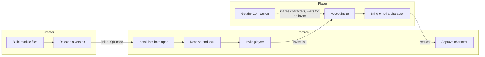
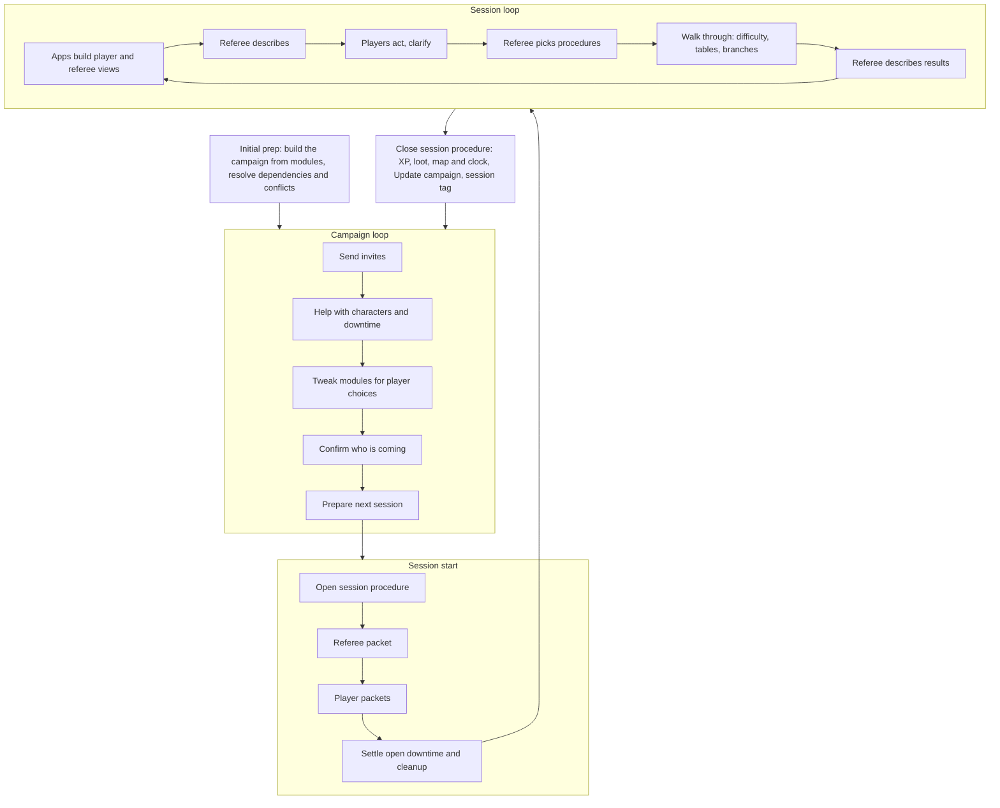

# E9 Workflows and Module Versioning

Status: agreed design, 2026-11-05 and 2026-11-07 (Heph). Not yet built. First draft: [Claude Doc](https://claude.ai/artifact/UpHCiv8Spi32u4nv3jDeDu).

## Summary

A module travels as one link. The referee stacks modules into a campaign that pins exact versions, and every conflict, update or ported character goes to the referee as a decision in the Inbox. This builds on what already exists: the mm-module/1 manifest ([MODULE_FORMAT.md](MODULE_FORMAT.md)), campaigns as git repos, and the Inbox approval flow.

**Everything is a module.** The core rules ship as modules (`e9-core`, `mm-core`), so the revised Compendium is a major update to `mm-core`. The apps are modules too (`e9-companion`, `e9-atlas`), so a module can require the app version it needs, and nothing exists outside the system.

| Piece | When |
| --- | --- |
| Module manifest with ids, versions and relationships | MVP |
| Atlas and Companion ingest from one link or QR code | MVP |
| Campaign lockfile, updates and conflict review | MVP |
| Invites and porting characters | MVP |
| Creator app (WYSIWYG module editor and publisher for other creators) | Post-MVP |

Until the creator app exists, modules are made with our repo tools (`tools/build.py` and the format specs).

## Three workflows

The three roles meet at two handoffs: the module link (creator to referee) and the invite (referee to player). Everything else each role does on their own.



- **Creator:** builds module files with our tools, releases a version, publishes the link, and puts its QR code on the back page of the print PDF.
- **Referee:** installs from the link (Atlas takes the setting, Companion the rules and NPCs), resolves conflicts and dependencies, adds house rules, locks versions, then invites players.
- **Player:** gets the Companion and maybe makes characters, accepts an invite, then sends an existing character or rolls a new one. The character arrives in the referee's Inbox for approval.

## Module package

A module is a git repo with one manifest at a stable URL, and that URL is the only thing anyone needs to install it.

- **Link format:** `https://<host>/<module>/module.json`, plus an optional `#v=1.2.0` to point at one version. Without a version, the app offers the latest one.
- **QR code:** printed on the back page of the print PDF. It encodes that same link, with the version that matches the printed book.
- **Two halves:** Atlas reads the setting half (regions, maps, sites, hex content). Companion reads the rules half (classes, gear, spells, creatures, NPCs, procedures, events). A module may have only one half, such as a pure rules supplement.
- **Releases are immutable.** Each version is a git tag, and its files never change after release. Errata ship as a new patch version.
- **Hosting:** GitHub Pages is the default, as now. Any static host works because the apps only read files.

## Versioning

Every piece of content has a permanent id, and each module's version number says whether an update can break the characters and campaigns that use it.

**Stable ids.** Ids look like `<module>/<kind>/<slug>`, for example `e9-core/spell/sleep` or `beyond-the-pale/creature/crom-cruach`. An id is never reused for something else. Renaming the display name is fine; renaming the id is a breaking change. Characters, parties and house rules point at ids, never at copies.

**Semantic versions, defined for game content** (the [semver](https://semver.org) rules, with game meanings):

| Bump | Example | Meaning for E9 |
| --- | --- | --- |
| Patch | 1.0.0 to 1.0.1 | Errata, typos, art, map fixes. No stat or rule changes anyone has to notice. |
| Minor | 1.0.1 to 1.1.0 | New content added. Existing ids keep their meaning. |
| Major | 1.1.0 to 2.0.0 | An id removed or renamed, a stat or rule changed in a way that changes existing characters or encounters. |

Each module, each app (E9 Companion, E9 Atlas) and the tools keep their own version (Heph 2026-11-06). A change to the tools or an app alone never bumps a module's version, and a module's content change never bumps an app. Each module keeps a `CHANGELOG.md` next to its `module.json`.

Versions before 1.0.0 make no promises, as in semver. The Compendium's revised edition (January 2027 at the earliest) would be a major version of `mm-core`.

**Release notes.** Every release lists its added, changed and removed ids. The apps use this list to show the referee what an update does.

## Dependencies

Each manifest says what it needs and what it touches, using the relationship types that [Foundry VTT](https://foundryvtt.com/article/module-development/) and [Factorio](https://wiki.factorio.com/Tutorial:Mod_structure) mods use.

| Field | Meaning | Example |
| --- | --- | --- |
| requires | Must be present, within a version range | `e9-core ^1.0` |
| recommends | Offered at install, can be skipped | `e9-bestiary ^1.2` |
| conflicts | Cannot share a campaign | `other-setting <2.0` |
| overrides | Ids from another module this one deliberately changes | `e9-core/spell/sleep` |
| system | Which rule system it is written for | `e9`, `mm`, or both |

Version ranges use the npm style: `^1.2` means 1.2 or any later 1.x. An override that is declared is applied quietly. Two modules changing the same id without declaring it is a conflict, and it goes to the referee.

```json
{
  "id": "beyond-the-pale",
  "version": "1.0.0",
  "system": ["e9", "mm"],
  "requires": { "e9-core": "^1.0", "e9-companion": "^0.5" },
  "recommends": { "e9-bestiary": "^1.0" },
  "overrides": ["e9-core/creature/goblin"]
}
```

**Honest contents.** A module may hold anything: both systems, setting and rules, art, procedures. But its manifest must list everything it contains, grouped by kind and system, with a count per group. The apps check the list against the actual files on install, and a mismatch is shown to the referee as a warning.

## Trust: bundles and checkers

Anyone can publish any module, overrides included. Trust comes from curators and checkers that the referee chooses, not from a central gatekeeper.

- **Bundles.** A bundle is a small signed list that says, in effect, "I'm Heph Fnord, and I think this curated list is pretty neat." It names modules with version ranges and an optional note for each. A bundle is itself a module, so it is versioned, linked and installed the same way. Installing a bundle offers its modules; it never installs anything silently.
- **Authors and curators.** Each manifest and bundle names its author and is signed with that author's key, so a copy can't pretend to be someone else's. The referee keeps a list of authors and curators they follow. Modules from outside that list install fine, but are marked as unvetted.
- **Checkers.** A checker is a script, shipped as a module, that reads a module and reports on it: honest contents, valid ids, power level against a reference, house style. Referees run the checkers they choose, or write their own. Official ones ship with `e9-core`.

This follows how package ecosystems like npm and Debian handle trust: open publishing, signed releases, and lists the user decides to believe.

## Campaign stack

A campaign is a stack of layers with one exact version each, and nothing changes in it until the referee says so.

1. **Core rules** (`e9-core` or `mm-core`).
2. **Modules**, in the order the referee sets. A later module wins over an earlier one.
3. **House rules**, always on top. This layer also stores every conflict decision the referee makes.

**Lockfile.** The campaign repo keeps `campaign.lock.json`, listing each module's exact version and a hash of its manifest, like npm's `package-lock.json` or Cargo's `Cargo.lock`. Players' apps load exactly those versions, so everyone at the table sees the same rules.

**One version per module.** npm can load two copies of a library side by side, but a campaign cannot have two Sleep spells. If two modules need incompatible versions of a third, the app reports it and the referee picks one or drops a module. There is no automatic solver.

**Updates.** The app checks the modules' links for newer versions and puts them in the Inbox. Patches and minors show their release notes and one Accept button. A major shows every changed or removed id that the campaign's characters actually use, and the referee decides per item.

**Conflicts.** At install and at every update, the app lists each id that two layers change without a declared override. For each, the referee picks one version, or writes a house-rule version. Like the user rules in the mod tool [LOOT](https://loot.github.io/), these decisions are saved in the house-rules layer, so they are still applied after the next update. A decision whose underlying id changed in an update is flagged for a second look.

**Slicing a module.** The referee can take the peas and leave the carrots. In the house-rules layer they can exclude any id, any group in the module's contents list (all its spells, say), or one system's half. Excluded content behaves as if it were missing: anything that needs it is flagged, the same way a conflict is.

**Players see the decisions.** Every conflict decision, exclusion and house rule is visible to players, with the referee's note. The referee can mark one decision as a spoiler, and players then see only that something was changed, not what.

## Porting characters and gear

A character from another campaign or ruleset arrives as an Inbox request, and the referee decides how to patch anything that doesn't fit.

1. The player picks an existing character and sends it with the join request, or sends it later.
2. The app checks every id on the sheet (class, origin, gear, spells, dweomers) against the campaign's lockfile.
3. Each id falls into one of four groups: **matches**, **different version** (the stats changed between versions), **missing** (its module isn't in the campaign), or **different system** (for example, a Materia Mundi character joining an E9 campaign).
4. The referee sees one review card with every flagged id. For each one they can keep it as house-ruled content, swap it for an id the campaign has, or remove it.
5. Approving writes the patched sheet into the campaign repo. The player's original stays untouched on their device.

The sheet's own history (creation and level-ups) is kept, so a ported character can be traced back. Gear on its own (a magic sword handed between campaigns) goes through the same check.

## Playing a campaign

Agreed with Heph, 2026-11-07. Everything a referee does at or between sessions runs on **one engine: Procedures** ([EVENTS_FORMAT.md](EVENTS_FORMAT.md)). Opening and closing a session, advancing the clock by hand, downtime and pushing a handout are all procedures, and each game defines its own.

### Devices: the phone is your hand, the laptop is your table

One person can be signed in on several devices at once. Pairing: the laptop shows a QR code, the phone scans it.

| Device | Role | Holds |
| --- | --- | --- |
| Referee laptop | Command centre, and the session host | Atlas (full map), Events log and trigger queue, open encounter, Inbox, clock |
| Referee phone | Remote | Dice, private notes, one-tap "run next trigger", "advance a turn", "call for a roll", rules lookup |
| Player phone | Hand (must be complete on its own) | Character sheet, dice, roll prompts, live HP, conditions, slots |
| Player laptop | Window (bigger views only, nothing laptop-only) | Player Atlas view, party, journal, rules wiki, session notes |
| Any screen (optional) | Table view, signed out | Shared map and roll log |

### Accounts

| Who | Account | Used for | Substitute |
| --- | --- | --- | --- |
| Everyone | Gmail | Sign-in, session calendar invites and RSVPs, the campaign Drive folder | Any email sign-in or passkey, later |
| Everyone, if online | Discord | Voice; webhook roll log; pushed descriptions and handouts where Discord fits best | none needed in person |
| Referee | GitHub | Campaign repo (the archive) and module library | Codeberg / Forgejo via the host adapter |
| Referee | A VTT | Tactical maps and tokens for fights | Foundry, Owlbear Rodeo or gTove |

Players need no GitHub account.

### Mailbox and archive

- **Mailbox:** a shared Google Drive folder per campaign. The referee's app creates it and shares it with the players' Gmail addresses when it sends invites. A player's request is a small file the app drops into the folder's inbox; the referee's app picks it up and removes it once handled. Each Update campaign also writes the current campaign snapshot here, so players can read a private campaign without GitHub.
- **Archive:** the campaign git repo. **Only the referee writes to it.**
- **Request states:** Sent → Approved (waiting in the batch) → Live, or Sent back with a note. Approvals collect in a batch; **Update campaign** commits the batch as one commit with a readable message. Closing a session is one more Update campaign plus the session tag.
- A small relay (Cloudflare) is added later only for players without Google.

### Live channel (remote play is a must)

- The **referee's laptop hosts the session**. Every other device connects straight to it, peer to peer (WebRTC).
- The **handshake goes through the Drive folder**: a joining device drops a "here I am" file and the host answers. No server of ours.
- **Fallback:** if a direct connection fails, that device sends its messages through the Drive folder (a few seconds each).
- **Discord** carries voice; the webhook mirrors every roll into the campaign channel.
- The session runs while the referee's laptop has the campaign open.

### VTTs

The Atlas already exports every encounter map as .uvtt plus a picture-only PNG ([ENCOUNTER_FORMAT.md](ENCOUNTER_FORMAT.md)). Foundry is the first adapter. Owlbear Rodeo takes the PNG, with walls and fog via an extension. **gTove** (no .uvtt) stores its maps in Google Drive, so the Atlas can drop the PNG into the gTove folder and the referee sets the grid once to the known scale; fog is painted by hand. To check before building: whether gTove can read the grid from the file.

### Downtime

Downtime actions are procedures, and each game sets its own (including any limits).

1. The player picks a downtime procedure in the Companion; the app rolls.
2. The roll posts at once to the campaign's Discord channel, marked pending ("Aoife carouses in Ceanannas Mór: 14 (pending referee)"). The post is a public witness: a reroll is a second post.
3. The same roll goes into the Drive mailbox as a request, with the Discord message id.
4. When the referee approves or sends it back, their app edits the Discord post to say so, and the result joins the Update campaign batch.

### The loops



**Initial prep.** Install modules, resolve dependencies and conflicts (Campaign stack, above).

**Campaign loop.**
- Send invites (link or QR code; shares the Drive folder).
- Help players with character creation and downtime (requests in the Inbox).
- Tweak modules for player choices (house-rules layer).
- Confirm who is coming: RSVPs on the session's calendar invite feed the next roll call.
- Prepare the next session.

**Session start.** The **Open session** procedure starts the clock and builds the hand-off packets:
- Referee: recap of the last session's log, pending requests, party position, scheduled events, prepared encounters.
- Each player: their character, the recap, handouts.
- Any unresolved downtime or cleanup is settled before play.

**Session loop.**
1. Atlas and Companion build the player-visible and referee-visible views of the current world state.
2. The referee describes the world.
3. Players describe their actions; back and forth to clarify.
4. The referee decides which procedures apply. The app shortlists them from context (in a hex: exploration turn, forage, get lost; at a door: listen, force, pick); the referee taps one.
5. The referee walks the players through it, choosing difficulty, tables and branches as they come up. Rolls go to players' phones or are rolled by the referee (EVENTS_FORMAT section 9).
6. The referee describes the results, and can **push** a description or handout to players, in the app or in Discord, whichever does the job best.
7. Loop.

**Session end.** The **Close session** procedure runs the game's XP and loot rules and proposes map and clock changes; the referee edits and approves; Update campaign commits it with the session tag. Back to the campaign loop.

**Advancing the clock by hand** is a deterministic procedure, not a special control.

## Sub-refs and West Marches

Agreed with Heph, 2026-11-07. A West Marches campaign has several referees, a party that forms fresh for each session, and one shared world. It uses the same model as above, one level up.

- **Head referee** owns the campaign repo and has the final say.
- **Sub-refs** are referees with a scope the head ref grants: a **region** of the Atlas (or a site or faction), **any session they run**, or both. The head ref chooses per sub-ref.
- **Secrets are scoped.** A sub-ref sees referee-only data inside their scope and nothing outside it.
- **Git.** Each referee writes their own session branch. A sub-ref's Update campaign becomes a request to the head ref, in the same Inbox flow players use. The head ref can mark a sub-ref as trusted, so their changes merge on their own, but only when nothing conflicts.
- **Conflicts between sessions** (two groups loot the same barrow) always go to the head ref, who decides.
- **Sessions.** Each session is posted to the calendar and Discord; players sign up; the party exists for that session only. Whoever runs it hosts the live channel. A game can require "end every session back in town", so characters are never stranded in a state another session collides with.
- **Shared map.** What any group explores is added to one player-visible Atlas layer that all players see.
- **Game time** (1:1 with real time, a clock per session that is reconciled later, or anything else) is set by a **procedure** the head ref picks, like everything else.

## Decisions and build order

**Decided by Heph (2026-11-05)**

- Core rules and the apps ship as modules. No content lives outside a module.
- A module may contain anything, but must honestly list what it contains. Referees can slice out any part.
- Players see the campaign's decisions, unless the referee marks one as a spoiler.
- Anyone can publish overrides. Trust comes from signed bundles by curators the referee follows, plus checkers the referee chooses to run.
- Porting characters and gear flags every mismatch to the referee, who decides the patch.
- The creator app (WYSIWYG module editor) is post-MVP.

**Decided by Heph (2026-11-07), campaign play**

- Devices: referee laptop + phone; each player a phone, ideally a laptop too. The phone is complete on its own.
- Accounts: Gmail for everyone, Discord when online, GitHub and a VTT for the referee (substitutes later).
- Players send requests; the referee approves into a batch and commits it with Update campaign. Only the referee writes git.
- The Drive folder is the mailbox, git is the archive.
- Remote play is required; the referee laptop hosts, peers connect directly.
- VTTs: Foundry, Owlbear Rodeo and gTove.
- Downtime rolls post to Discord as pending until the referee approves.
- One engine: session open/close, clock advance, downtime and pushes are all procedures, defined per game.
- Sub-refs: scope by region, session or both (head ref's choice); game-time model is a procedure; the head ref always decides conflicts between sessions.

**Suggested build order** (each step is one PR, after the Full Sheet cleanup and campaigns-as-git steps already queued)

1. Add ids, version, relationships, contents list and release notes to the manifest spec ([MODULE_FORMAT.md](MODULE_FORMAT.md)), and stamp them on Beyond the Pale.
2. Install from one link in Companion and Atlas, with the QR code in the print PDF.
3. Campaign lockfile and the layer stack.
4. Conflict review and update cards in the Inbox.
5. Invites by link or QR code.
6. Porting characters and gear.
7. Bundles, author signatures and checkers.
8. Campaign Drive folder: invites share it, requests and snapshots go through it, Update campaign batch.
9. Device pairing and the live channel (WebRTC with Drive handshake), roll prompts to phones.
10. Open session and Close session procedures, packets, recap; procedure shortlist; push to app or Discord.
11. Downtime procedures with Discord witness posts.
12. gTove export.
13. Sub-refs and West Marches: scoped referee roles, session branches with head-ref merge, per-session parties, shared player map layer. Then, post-MVP, the creator app.
